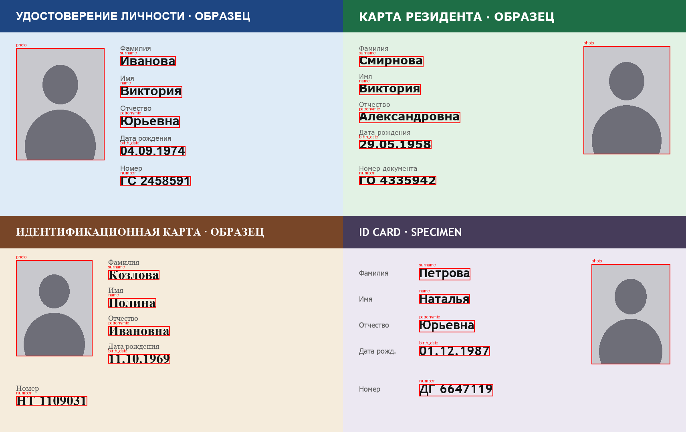
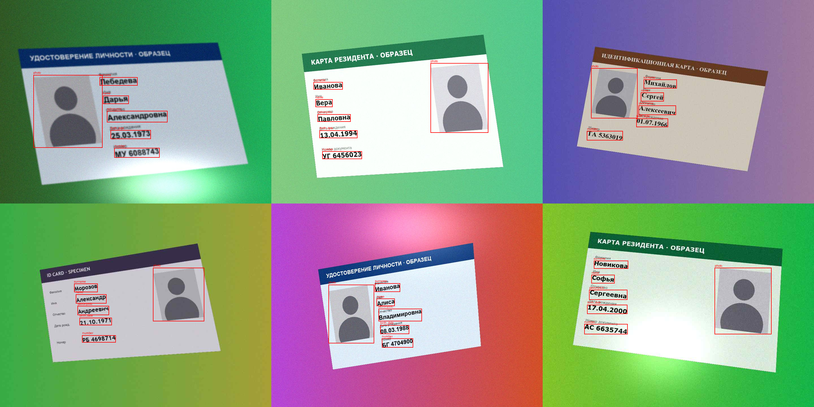
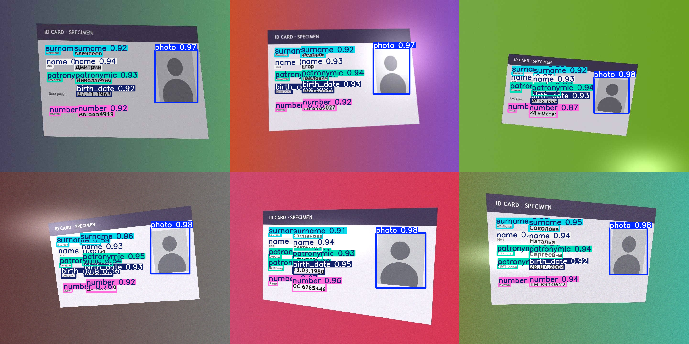
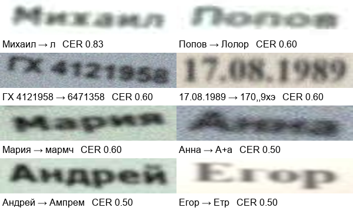

# Document Recognition

Recognition of identity documents on fully synthetic data. A generator draws fictional ID
cards and labels every field automatically, a YOLO detector finds the fields on photo-like
images, and EasyOCR reads them. No real documents or personal data are used.

[Русская версия](README.ru.md)

## Results

| Stage | Seen templates (A, B, C) | Unseen template (D) |
|---|---|---|
| Detection, mAP50 / mAP50-95 | 0.995 / 0.983 | 0.987 / 0.927 |
| Detection, images with exactly 6 boxes | 299 / 300 | **2 / 300** |
| OCR on detected boxes, CER | 0.052 | 0.031 |
| OCR on detected boxes, fields read exactly | 78% | 88% |
| Documents with all 5 text fields correct | 52% | 76% |

Main findings:

- **mAP hides the real problem.** On the unseen template mAP50 is still 0.987, but the model
  adds 4.3 extra boxes per image: it marks field labels ("Фамилия", "Имя") as values. These
  false positives have lower confidence, so they barely affect mAP. Taking the most confident
  box per class removes them, and OCR on the unseen template stays almost as good as with
  ground-truth boxes (CER 0.031 vs 0.026).
- **OCR, not detection, is the bottleneck.** Switching from ground-truth to detected boxes
  adds only about 0.005 CER. Almost all errors come from reading strongly blurred text.
- **Field-level accuracy overstates document-level accuracy.** 78% of fields are read exactly,
  but only 52% of documents have all five fields right, and a document is only useful when every
  field is right.

## Pipeline

**1. Synthetic documents.** Four fictional templates with different layouts and fonts, filled
with random names, birth dates and document numbers. Field boxes come straight from the
renderer (`ImageDraw.textbbox`), so labels are exact and free.



**2. Phone photo augmentation.** Perspective, rotation, background, brightness and contrast,
glare, blur, noise and JPEG compression. Field boxes are moved with the same perspective matrix.



**3. Field detection.** YOLO11n, 6 classes (`photo`, `surname`, `name`, `patronymic`,
`birth_date`, `number`), 30 epochs, horizontal flips off because documents are never mirrored.

| Split | Images | Templates | Purpose |
|---|---|---|---|
| train | 1500 | A, B, C | training |
| val | 300 | A, B, C | model selection |
| test_seen | 300 | A, B, C | new people, known layouts |
| test_unseen | 300 | D | a layout the model has never seen |

Template D puts the value to the right of its label instead of below it. On these images the
model finds every field, but it also marks the labels:



**4. OCR.** Each detected field is cropped and read with EasyOCR (Russian model). Quality is
measured on 100 images per split with the character error rate (CER, Levenshtein distance
divided by the length of the true text) and exact match.

| Experiment | CER | Exact match |
|---|---|---|
| seen, ground-truth boxes, `recognize` | 0.048 | 79% |
| seen, ground-truth boxes, `readtext` | 0.159 | 63% |
| seen, YOLO boxes, `recognize` | 0.052 | 78% |
| unseen, ground-truth boxes, `recognize` | 0.026 | 89% |
| unseen, YOLO boxes, `recognize` | 0.031 | 88% |

`readtext` searches for text inside the crop again and often cuts it, so when the box is already
known, `recognize` is three times better. The unseen template reads better because its bold
sans-serif fonts are easier than thin Verdana (B) and serif Georgia / Times (C). EasyOCR is
pretrained and never saw any of the templates, so "seen" and "unseen" only matter for the
detector.

Worst OCR errors (true text → prediction): all of them are strongly blurred.



## Personal data

Passports and ID cards contain personal data, and a face photo is biometric data. Processing
them requires a legal basis and protected storage. This project uses only generated documents with
made-up names and a drawn silhouette instead of a face, the same approach that research
datasets such as MIDV-2020 take.

## What next

- More diverse templates, or a separate `label` class, so that the detector learns the
  difference between a label and a value.
- Oriented boxes or rectifying the card with its four corners before OCR, so that crops are
  straight.
- Fine-tuning the OCR recognizer on synthetic crops, especially blurred ones.
- Logging augmentation parameters to measure CER as a function of blur, glare and JPEG quality.
- Field validation: date format, number format, checks between fields.

## Reproduce

Tested on macOS (the renderer uses system fonts from `/System/Library/Fonts/Supplemental`).

```bash
pip install -r requirements.txt
python -m src.make_dataset        # 2400 images in data/, about a minute
python -m pytest                  # tests for the generator, augmentation and metrics
```

Then run [`01_document_recognition.ipynb`](01_document_recognition.ipynb): it trains the
detector (about 25 minutes on Apple Silicon) and runs every experiment above.

## Repository layout

```
.
├── src/
│   ├── fake_person.py      # random fictional people
│   ├── render_card.py      # ID card templates and rendering with exact field boxes
│   ├── augment.py          # phone photo augmentation that moves the boxes too
│   ├── make_dataset.py     # dataset in YOLO format
│   ├── ocr.py              # cropping, EasyOCR, evaluation
│   └── metrics.py          # Levenshtein distance and CER
├── tests/                  # pytest tests
├── docs/images/            # report images
├── 01_document_recognition.ipynb
└── requirements.txt
```

## License

[MIT](LICENSE)
