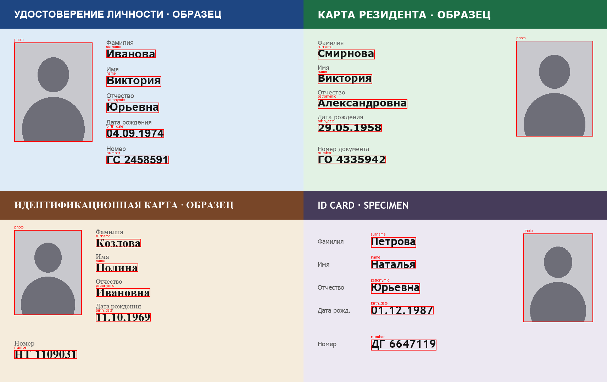
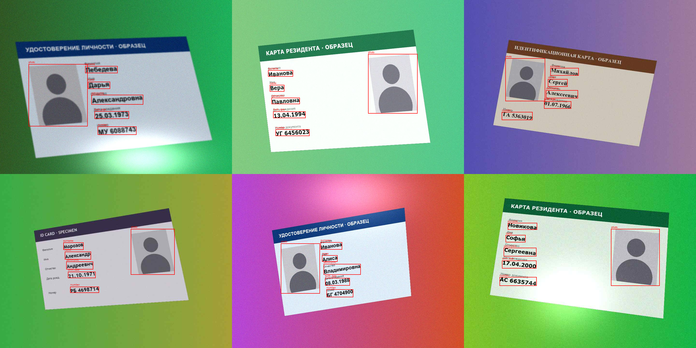
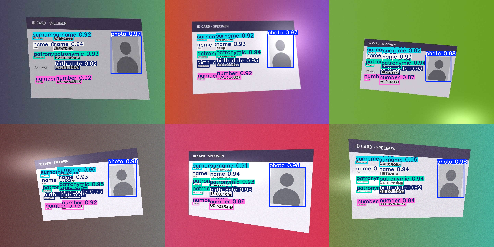
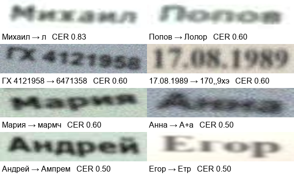

# Document Recognition

Распознавание документов, удостоверяющих личность, на полностью синтетических данных.
Генератор рисует вымышленные ID-карты и сам размечает каждое поле, детектор YOLO находит поля
на изображениях, похожих на фото с телефона, а EasyOCR их читает. Настоящие документы и
персональные данные не используются.

[English version](README.md)

## Результаты

| Этап | Знакомые шаблоны (A, B, C) | Новый шаблон (D) |
|---|---|---|
| Детекция, mAP50 / mAP50-95 | 0.995 / 0.983 | 0.987 / 0.927 |
| Детекция, картинок ровно с 6 рамками | 299 / 300 | **2 / 300** |
| OCR по найденным рамкам, CER | 0.052 | 0.031 |
| OCR по найденным рамкам, полей прочитано без ошибок | 78% | 88% |
| Документов, где верны все 5 текстовых полей | 52% | 76% |

Главные выводы:

- **mAP скрывает настоящую проблему.** На новом шаблоне mAP50 по-прежнему 0.987, но модель
  добавляет 4.3 лишние рамки на картинку: она принимает подписи полей («Фамилия», «Имя») за
  значения. У этих ложных срабатываний уверенность ниже, поэтому на mAP они почти не влияют.
  Если брать по одной самой уверенной рамке на класс, лишние рамки уходят, и OCR на новом
  шаблоне работает почти так же, как по правильным рамкам (CER 0.031 против 0.026).
- **Узкое место OCR, а не детекция.** Замена правильных рамок на найденные добавляет к CER всего
  около 0.005. Почти все ошибки возникают при чтении сильно размытого текста.
- **Точность по полям завышает точность по документам.** Без ошибок читается 78% полей, но
  все пять полей верны только в 52% документов, а документ полезен, только когда верно каждое поле.

## Пайплайн

**1. Синтетические документы.** Четыре вымышленных шаблона с разной вёрсткой и шрифтами,
заполненные случайными ФИО, датами рождения и номерами. Рамки полей берутся прямо из отрисовки
(`ImageDraw.textbbox`), поэтому разметка точная и бесплатная.



**2. Аугментации под фото с телефона.** Перспектива, поворот, фон, яркость и контраст, блик,
размытие, шум и сжатие JPEG. Рамки полей двигаются той же матрицей перспективы.



**3. Детекция полей.** YOLO11n, 6 классов (`photo`, `surname`, `name`, `patronymic`,
`birth_date`, `number`), 30 эпох, горизонтальные отражения выключены, потому что зеркальных
документов не бывает.

| Выборка | Картинок | Шаблоны | Зачем |
|---|---|---|---|
| train | 1500 | A, B, C | обучение |
| val | 300 | A, B, C | выбор лучшей эпохи |
| test_seen | 300 | A, B, C | новые люди, знакомая вёрстка |
| test_unseen | 300 | D | вёрстка, которую модель не видела |

В шаблоне D значение стоит справа от подписи, а не под ней. На этих картинках модель находит
все поля, но заодно отмечает и подписи:



**4. OCR.** Каждое найденное поле вырезается и читается EasyOCR (русская модель). Качество
считается на 100 картинках каждой выборки: доля ошибок в символах (CER, расстояние Левенштейна,
делённое на длину правильного текста) и доля полей без единой ошибки (exact match).

| Эксперимент | CER | Exact match |
|---|---|---|
| seen, правильные рамки, `recognize` | 0.048 | 79% |
| seen, правильные рамки, `readtext` | 0.159 | 63% |
| seen, рамки YOLO, `recognize` | 0.052 | 78% |
| unseen, правильные рамки, `recognize` | 0.026 | 89% |
| unseen, рамки YOLO, `recognize` | 0.031 | 88% |

`readtext` заново ищет текст внутри вырезки и часто его обрезает, поэтому, когда рамка уже
известна, `recognize` втрое лучше. Новый шаблон читается легче, потому что жирные шрифты без
засечек проще тонкого Verdana (B) и шрифтов с засечками Georgia / Times (C). EasyOCR
предобучен и не видел ни одного шаблона, так что «знакомый» и «новый» важны только для детектора.

Худшие ошибки OCR (правильный текст → предсказание): все они на сильно размытых картинках.



## Персональные данные

В паспортах и ID-картах есть персональные данные, а фото лица относится к биометрическим.
Для их обработки нужно законное основание и защищённое хранение. Здесь используются только
сгенерированные документы с выдуманными ФИО и нарисованным силуэтом вместо лица, так же как в
исследовательских датасетах вроде MIDV-2020.

## Что дальше

- Больше разных шаблонов или отдельный класс `label`, чтобы детектор научился отличать подпись
  от значения.
- Повёрнутые рамки или выравнивание карточки по четырём углам перед OCR, чтобы вырезки были ровными.
- Дообучение распознавателя OCR на синтетических вырезках, особенно размытых.
- Логирование параметров аугментаций, чтобы измерить CER в зависимости от размытия, блика и
  качества JPEG.
- Проверка полей: формат даты, формат номера, согласованность полей между собой.

## Как воспроизвести

Проверено на macOS (для отрисовки нужны системные шрифты из `/System/Library/Fonts/Supplemental`).

```bash
pip install -r requirements.txt
python -m src.make_dataset        # 2400 картинок в data/, около минуты
python -m pytest                  # тесты генератора, аугментаций и метрик
```

Потом запусти [`01_document_recognition.ipynb`](01_document_recognition.ipynb): он обучает
детектор (около 25 минут на Apple Silicon) и проводит все эксперименты выше.

## Структура

```
.
├── src/
│   ├── fake_person.py      # случайные вымышленные люди
│   ├── render_card.py      # шаблоны ID-карт и отрисовка с точными рамками полей
│   ├── augment.py          # аугментации под фото с телефона, рамки двигаются вместе с карточкой
│   ├── make_dataset.py     # датасет в формате YOLO
│   ├── ocr.py              # вырезка полей, EasyOCR, оценка
│   └── metrics.py          # расстояние Левенштейна и CER
├── tests/                  # тесты pytest
├── docs/images/            # картинки для отчёта
├── 01_document_recognition.ipynb
└── requirements.txt
```

## Лицензия

[MIT](LICENSE)
